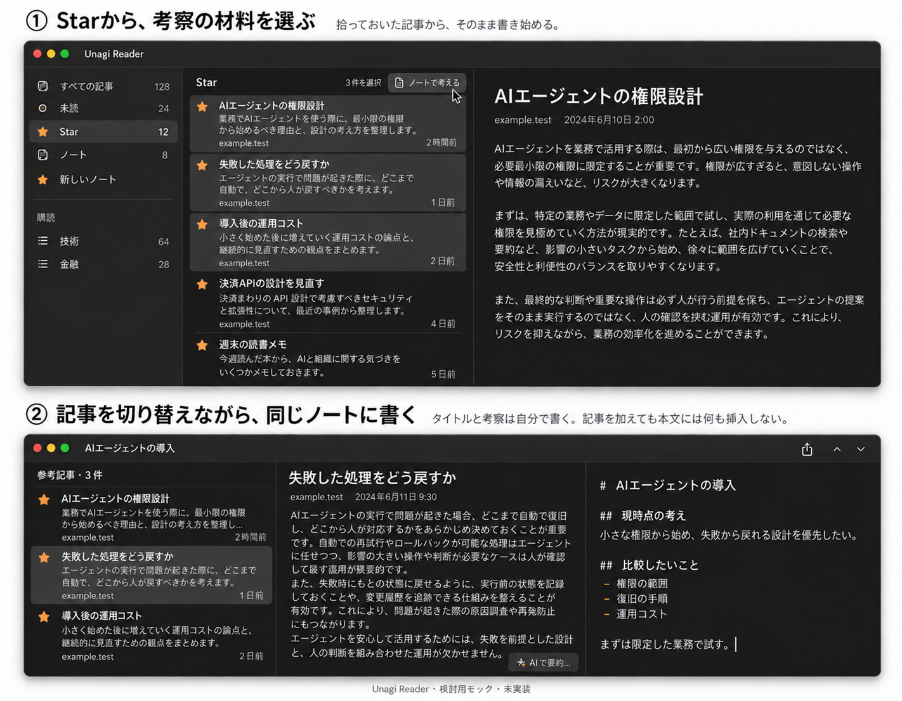

# From Star to a note: a reading and thinking flow

Status: discussion proposal for owner and Claude review. Not approved for implementation.
Date: 2026-10-12. Baseline: `1329f4f` (current `main` when this paper was prepared).

## Purpose

The owner wants to think about a subject chosen in advance, using several articles as material. They want to move quickly between those articles while keeping one note open and writing their own conclusions. The difficulty is moving from smooth RSS reading to writing without first doing note-management work.

This proposal uses the current reader and note panel. It does not add a separate topic, collection, project, or goal object. It asks whether the user can start thinking from articles they have already picked, without first creating and naming a note.

## Current behavior

The [Vision](../vision.md) promises a smooth read → note → ask AI → understand loop, local data, explicit AI, and few things to manage.

The [specification, sections 3.2–3.3 and 5.1](../specification.md) currently defines:

- Star as an independent “think about this later” mark. Adding or removing a note reference does not change Star.
- A note as one Markdown document, with its title derived from its first non-empty line. Notes can be created and managed independently.
- Article-to-note references created only by sending a summary. Sending also appends AI text or the RSS-summary fallback to the note body. There is no reference-only action.
- A destination menu for each send: a new note or one of up to eight recent notes.
- A note view with its article list, article body, and a resizable editor on the right. The sidebar folds only when the window is narrow. Article navigation is available while editing through `⌥⌘↑` / `⌥⌘↓`.

The current layout already supports reading an article group while writing. The proposed changes concern how the user gets there and whether collecting articles must change their writing.

## Proposed meaning of Star, a note, and reference articles

| Item | User intention |
|---|---|
| Star | “Keep this; I may want to read or use it later.” No subject choice required. |
| Note | “Develop my thinking about this subject.” One lasting piece of writing. |
| Reference article | “Use this article as material for this note.” Shown beside the writing. |

Keep Star independent in meaning, but connect it closely to writing through the interaction. Using an article in a note should not remove its Star. Removing Star should not remove a note reference. An article may support more than one note.

The user should not have to create a separate collection before creating a note. One note contains their writing and its reference articles. Article references do not need to be embedded in the Markdown body.

Independent note creation remains useful when the owner already wants to write about a subject. Removing that entry point is not proposed. The hypothesis is that mandatory setup and repeated destination choices cause friction, rather than the existence of notes itself.

## Proposed flow

1. Read RSS normally. Use existing feeds and folders for broad narrowing. Star interesting articles without choosing a note.
2. In Star, select several articles and choose the proposed action **「ノートで考える」** (“Think in a note”). The first flow to examine creates a note with those reference articles and opens it. It does not require a naming dialog or insert summaries into the note body.
3. Keep the current article visible if it is among the selected articles. If it is not, choose a predictable initial article; the exact rule is open. The article list becomes the chosen reference articles.
4. Open the note inspector from the right. When space is limited, the left sidebar folds away. Keep the article visible through the transition, rather than covering it with the editor. A wide window can keep all four regions.
5. Write a title and thoughts when ready. Switch reference articles while keeping the same note, caret, and writing scroll position. The note title continues to come from the user's first line.
6. Return to RSS or Star when more material is needed. Restore the previous scope, list position, selection, and article reading position. Return to the note without losing writing context.

There is no required “collection complete” step. Reading, adding material, and writing may alternate.

The editor's open/close control only shows or hides the editor. It must not silently navigate back to Star. Returning to RSS or Star is a separate navigation action whose exact presentation needs review.

For later additions, consider keeping one visible destination so the user does not select the same note repeatedly. This is a secondary question, not a settled requirement. Its lifetime and behavior on note deletion need decisions. Direct addition from RSS should remain possible without requiring Star first.

## Demo image

The upper scene selects three articles in Star. The lower scene shows the resulting note after the user has written a title and thoughts and switched to another reference article. These are two moments in one flow, not new app modes.

This is an imagegen concept using synthetic content and the earlier code-based Unagi Reader mockup as a visual reference. It is not a screenshot or an implemented interaction. Star remains set in both scenes. The displayed title and prose represent user writing, not automatic AI output.

The generator placed a star beside 「新しいノート」 in the sidebar; that icon is an illustration error, not a proposed control. Toolbar positions, labels, spacing, and the selection treatment are provisional. The image cannot demonstrate animation, focus, position preservation, or usability.

## Separate article collection from AI writing

Adding a reference article should save its reference without appending anything to the note body or starting inference. This is a proposed change to the current contract, including its non-AI RSS-summary append.

Foundation Models can remain an explicit aid for understanding the displayed article. One option is **「AIで要約…」** (“Summarize with AI”) → inspect a marked draft → explicitly insert or dismiss. This is not approved. It needs review against the current summary-send action and the previously simplified V1 scope.

Collection and writing must work with AI off. AI should not block reading, rewrite notes automatically, or silently insert into a stale note or cursor position. Multi-article AI synthesis, automatic classification, and AI-driven article selection are outside this proposal.

Keep existing privacy, retention, input-coverage, and Claude handoff promises. A reference does not make expired full text available. Adding a reference should not extend full-text retention or silently fetch an original page. Existing note text must not be rewritten to adopt this flow.

## Trade-offs and open questions

| Question | Recommendation or issue to examine |
|---|---|
| Does Star duplicate the reference list? | Treat Star as unassigned interest and references as material in use. Test whether users still feel they must maintain both lists. |
| How does the user know an article is already used? | Consider an on-demand indication of the notes using it. Avoid a new field or badge the user must maintain. Exact presentation is open. |
| New or existing note? | The demo covers a new note. Review a small route to an existing note without adding mandatory setup. |
| Can several articles be selected smoothly? | Audit the current native list before choosing mouse and keyboard behavior. This proposal does not claim multi-selection is already supported. |
| What happens when the same reference is added again? | Recommend an honest “Already added” no-op. This must remain distinct from intentionally inserting another summary. |
| What happens on partial save failure? | Decide whether creating a note with several references is atomic, and how undo works. Never show success for unsaved references. |
| What is retained in a reference? | Preserve the current saved title, URL, and RSS-summary contract unless separately changed. No claim is made that the store needs no changes. |
| How is an untitled note recognized later? | Avoid forcing a title before writing; test discoverability and empty-note clutter. The demo shows a later, user-written title. |
| Does a remembered destination help or misroute articles? | Keep it visible and easy to clear; choose session or persistent lifetime only after trying the flow. |
| Does the slide preserve reading comfort? | Prefer the existing standard split view and inspector. Check wrapping, width, article position, focus, and Reduce Motion on a real Mac. |

## Questions for Claude

1. Does this reduce preparation and repeated choices, or just move them elsewhere? Walk through Star → three articles → first written thought.
2. Are Star and reference articles distinct enough without teaching another management system? Suggest a simpler flow if one exists.
3. Does a note remain the right unit for one subject's writing and material? Consider several notes using one article, changing subjects, and unnamed notes.
4. What conflicts with the current Vision, specification, or decisions? In particular, is an optional AI preview worth bringing back after V1 simplification?
5. Where could multi-selection, sidebar folding, or article-list changes lose reading and writing context? Keep editor visibility separate from navigation.
6. Which product decisions are essential before implementation? Identify store, save failure, undo, retention, and stale AI risks without expanding the feature set.

Please review this as a discussion proposal, not as an approved implementation plan. Do not infer runtime behavior from the generated image.

## Validation and scope

For this docs-only PR: check Markdown links, the image, and `git diff --check`. No app code, dependency, schema, Vision, specification, or approved decision record changes are included. No implementation plan or new verification record is needed for the proposal.

A future synthetic usability check should cover selecting three articles, opening a note, writing while switching articles, returning for more material, and resuming at the same positions. Repeat with AI off. Include keyboard selection, real Japanese IME, narrow/wide windows, Reduce Motion, VoiceOver, save failure, and cancelled or stale AI drafts before claiming those behaviors work.

The earlier synthetic launch attempts in this conversation failed in the tool environment; the owner reported that ordinary app launch works on their Mac. No live app screenshot, animation check, Foundation Models probe, or product acceptance is claimed here.

## References

- [Current note layout and summary choices: decision 0019](../decisions/0019-v1-simplification-notes.md)
- [Current summary-send contract: decision 0020](../decisions/0020-summary-send-contract.md)
- [Reader layout and actions](../../Sources/UnagiReader/ReaderView.swift)
- [Note panel and editing navigation](../../Sources/UnagiReader/NotePanel.swift)
- [Current color palette](../../Sources/UnagiReader/AppPalette.swift)
- [Existing note-editor verification and its limits](../verification/s5-editor-styling.md)
